<p align="center">
  
</p>

<h1 align="center">Tanya Saham AI</h1>

<p align="center">
  Chatbot analisa saham Bursa Efek Indonesia berbasis <b>Google Gemini</b>, dengan data pasar dari <b>MCP InvestSaham</b> dan materi dari ebook InvestSaham.
</p>

<p align="center">
  
  
  
  
  
</p>

## Demo

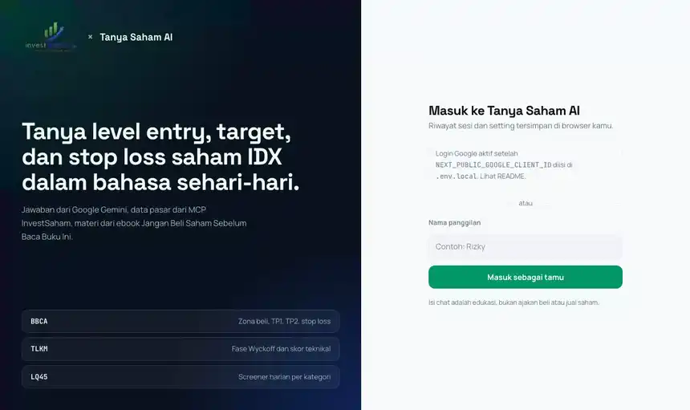

Alurnya: login sebagai tamu, kirim pertanyaan, buat sesi baru, ganti judul sesi, buka Setting (API key, model dan gaya, skill, embed), lalu widget di website lain. Video versi MP4 ada di [`docs/demo.mp4`](docs/demo.mp4).

Di video, API key Gemini belum diisi, jadi bot menjawab dengan pesan error yang meminta key. Setelah key diisi di Setting, bot menjawab dengan data MCP InvestSaham.

## Daftar isi

- [Demo](#demo)
- [Use case](#use-case)
- [Fitur](#fitur)
- [Screenshot](#screenshot)
- [Cara menjalankan](#cara-menjalankan)
- [Cara mendapatkan API key](#cara-mendapatkan-api-key)
- [Konfigurasi parameter](#konfigurasi-parameter)
- [Arsitektur](#arsitektur)
- [API `/api/chat`](#api-apichat)
- [Embed widget](#embed-widget)
- [Struktur folder](#struktur-folder)
- [Deploy](#deploy)
- [Disclaimer](#disclaimer)

## Use case

Tanya Saham AI adalah **education bot dan asisten analisa saham** untuk investor pemula di Indonesia. Pengguna bertanya dalam bahasa sehari-hari, misalnya "BBCA masih bisa entry ga? modal 10 juta". Bot lalu:

1. Mengambil data teknikal terbaru dari MCP InvestSaham: harga, fase Wyckoff, zona beli, TP, stop loss, dan skor.
2. Menjelaskan data itu dengan aturan skill **Technical Analysis Megaprofit** (`investsaham-analisa`).
3. Menjawab pertanyaan konsep dengan materi ebook **Jangan Beli Saham Sebelum Baca Buku Ini**.

Project ini dibuat untuk tugas akhir kelas **AI Productivity and AI API Integration for Developers** (Hacktiv8). Syarat tugas: chatbot berbasis LLM dengan use case dan parameter kreatif.

## Fitur

| Fitur | Keterangan |
|---|---|
| Model AI | Google Gemini lewat SDK `@google/genai`, method `generateContent()` |
| Integrasi API eksternal | MCP InvestSaham: `get_asset_analysis` dan `ihsg_screener`, dipanggil otomatis lewat function calling |
| Gaya bahasa | Formal, santai, atau mentor |
| Level pengguna | Pemula, menengah, atau trader |
| Parameter model | Pilihan model Gemini dan `temperature` 0.0 sampai 2.0 |
| System instruction | Persona, batas topik, skill analisa, materi ebook, dan instruksi tambahan dari pengguna |
| Memory | Bot membaca 20 pesan terakhir di sesi yang sama. Bisa dimatikan |
| Multi sesi | Sidebar seperti WhatsApp: tambah sesi, tutup sesi, cari sesi, dan **ganti judul sesi** (klik pensil atau klik dua kali judul) |
| Login | Google Sign-In (Gmail) atau mode tamu |
| Setting | API key Gemini, API key InvestSaham, model, gaya, skill, dan kode embed |
| Widget embed | Bubble chat di pojok kanan bawah website mana pun, cukup satu tag `<script>` |
| UX | Skeleton loading, animasi Framer Motion, dark mode otomatis, responsive sampai layar HP |

## Screenshot

| Analisa saham dengan data live MCP | Pertanyaan konsep dari materi ebook |
|---|---|
| 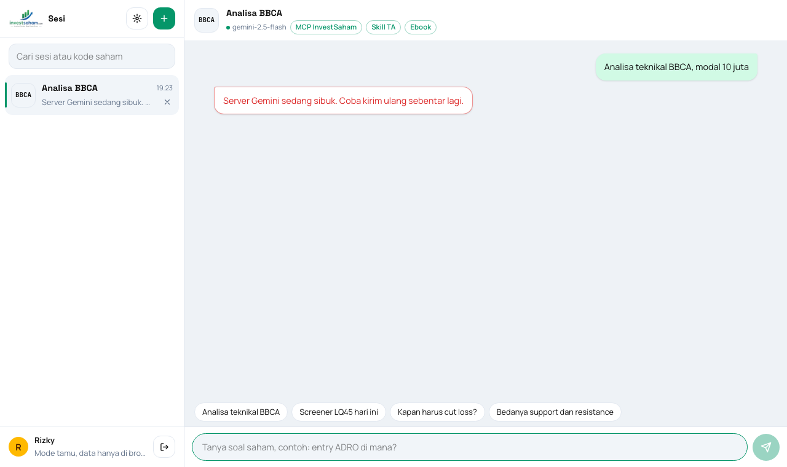 | 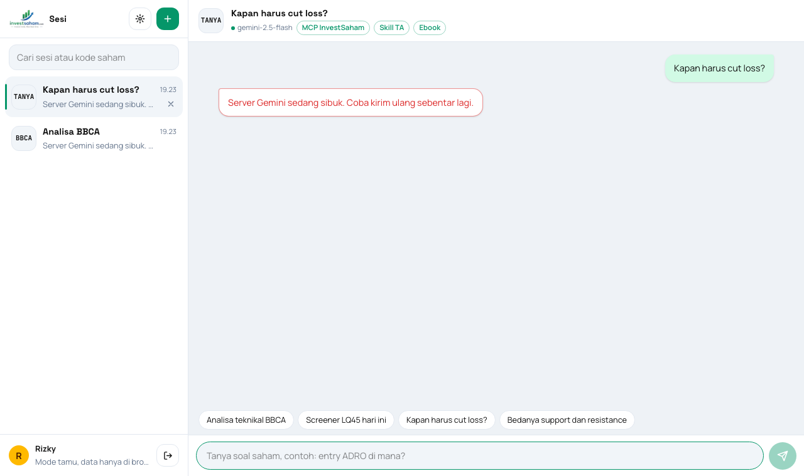 |

| Widget menjawab di website lain | PDF semua halaman UI |
|---|---|
| 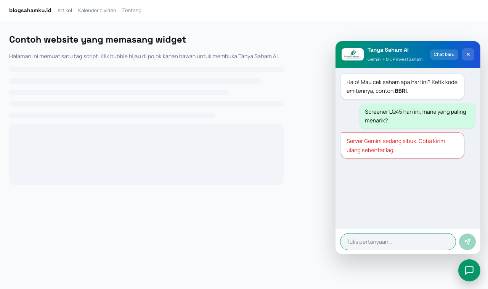 | [docs/UI-Tanya-Saham-AI.pdf](docs/UI-Tanya-Saham-AI.pdf) |

| Login | Login (dark mode) |
|---|---|
| 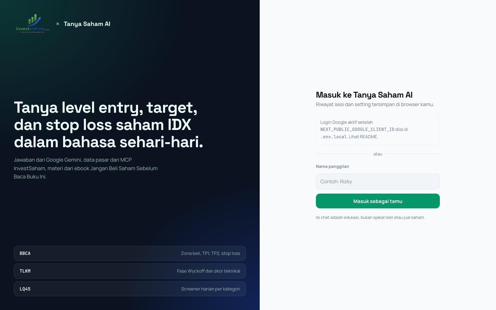 | 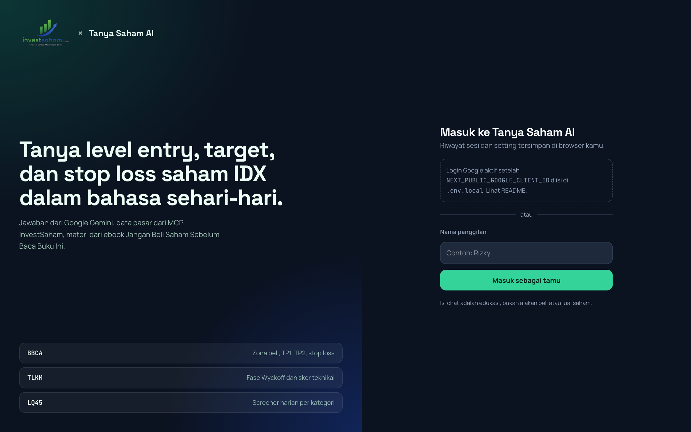 |

| Daftar sesi | Ganti judul sesi |
|---|---|
| 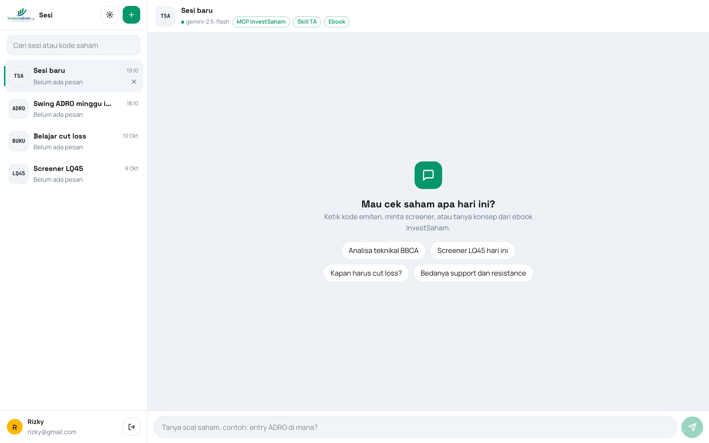 | 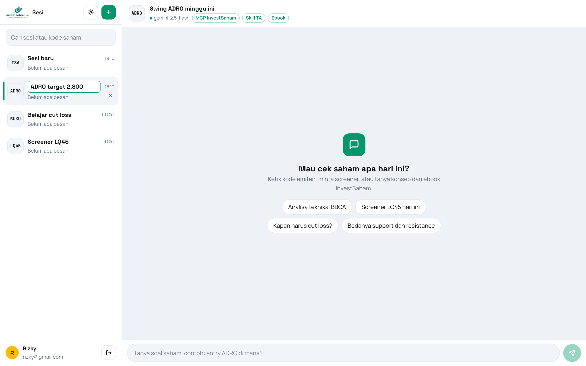 |

| Setting: API key | Setting: model & gaya |
|---|---|
| 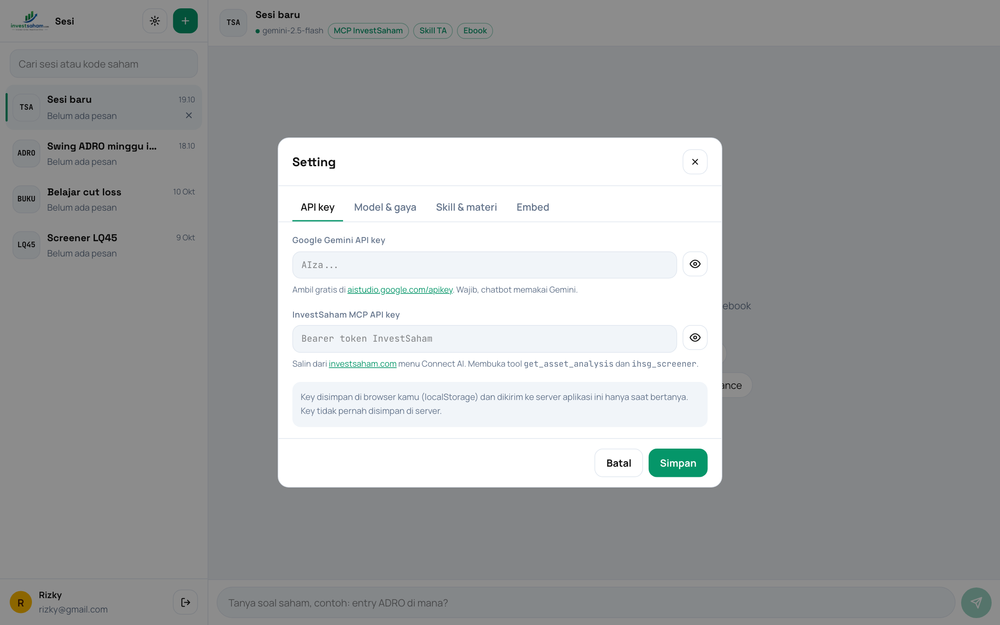 | 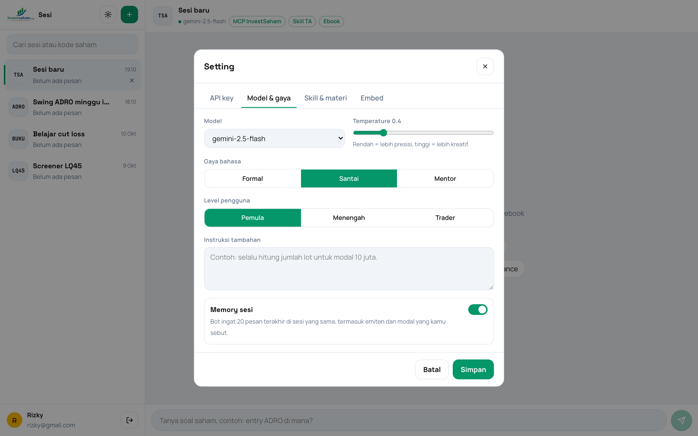 |

| Setting: embed | Widget di website lain |
|---|---|
| 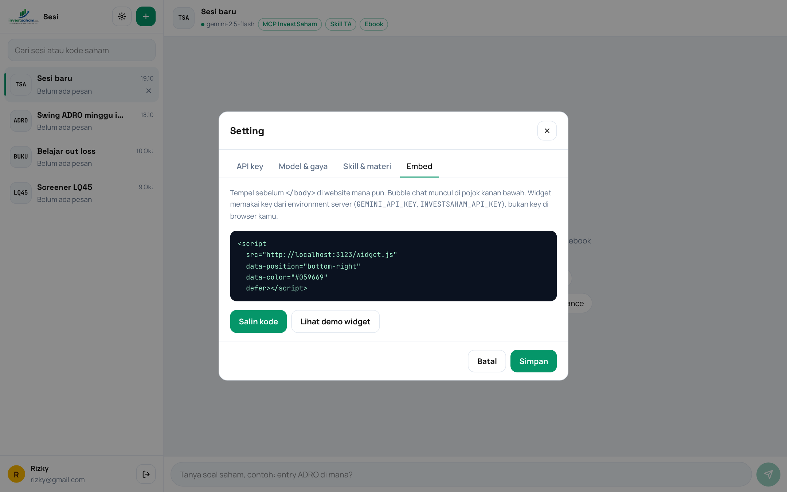 | 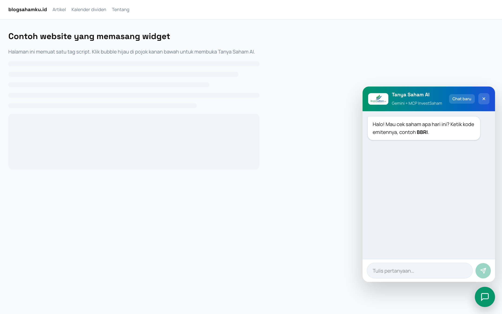 |

| Mobile |
|---|
| 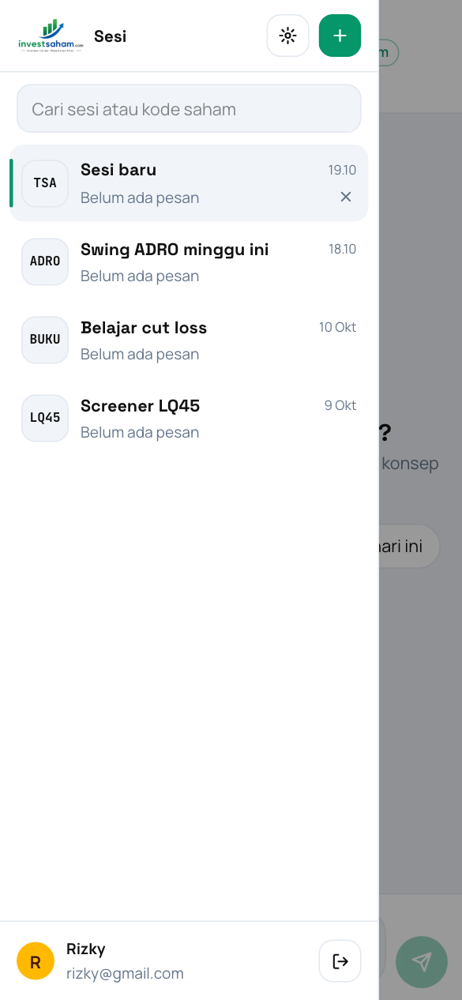 |

## Cara menjalankan

Kebutuhan: **Node.js 20 atau lebih baru** dan npm.

```bash
git clone https://github.com/MFauzi09/tanya-saham-ai.git
cd tanya-saham-ai
npm install
cp .env.example .env.local
npm run dev
```

Buka http://localhost:3000, masuk dengan Google atau sebagai tamu, lalu buka **Setting** dan tempel API key kamu.

Perintah lain:

| Perintah | Fungsi |
|---|---|
| `npm run dev` | Server development di port 3000 |
| `npm run build` | Build production |
| `npm start` | Jalankan hasil build |
| `npm run lint` | Cek kode dengan ESLint |

## Cara mendapatkan API key

Kamu cukup copy dua key, lalu tempel di menu **Setting > API key**.

### 1. Google Gemini API key (wajib)

1. Buka https://aistudio.google.com/apikey dan login dengan akun Google.
2. Klik **Create API key**.
3. Copy key yang diawali `AIza...`.
4. Tempel di Setting, kolom **Google Gemini API key**.

### 2. InvestSaham MCP API key (untuk data saham live)

1. Buka https://investsaham.com dan login.
2. Buka menu **Connect AI**.
3. Copy API key MCP kamu.
4. Tempel di Setting, kolom **InvestSaham MCP API key**.

Tanpa key InvestSaham, atau kalau key salah, bot tetap menjawab. Bot menjelaskan cara menganalisa saham itu dari materi ebook, tidak mengarang harga terkini, lalu menyarankan isi key untuk data live.

### 3. Google Client ID (opsional, untuk tombol login Gmail)

1. Buka https://console.cloud.google.com/apis/credentials.
2. Klik **Create credentials > OAuth client ID**, pilih **Web application**.
3. Isi **Authorized JavaScript origins** dengan `http://localhost:3000` dan domain deploy kamu.
4. Copy **Client ID** ke `.env.local` sebagai `NEXT_PUBLIC_GOOGLE_CLIENT_ID`.

### Isi `.env.local`

```bash
GEMINI_API_KEY=
INVESTSAHAM_API_KEY=
NEXT_PUBLIC_GOOGLE_CLIENT_ID=
```

| Variabel | Wajib | Dipakai untuk |
|---|---|---|
| `GEMINI_API_KEY` | Tidak, kalau pengguna isi key di Setting | Key cadangan di server. Wajib untuk widget embed |
| `INVESTSAHAM_API_KEY` | Tidak | Key cadangan MCP di server. Dipakai widget embed |
| `NEXT_PUBLIC_GOOGLE_CLIENT_ID` | Tidak | Tombol login Google. Tanpa ini, tersedia mode tamu |
| `INVESTSAHAM_MCP_URL` | Tidak | Default `https://investsaham.com/api/mcp` |

Key yang diisi di Setting tersimpan di localStorage browser pengguna. Key itu dikirim ke server lewat header hanya saat bertanya, dan server tidak menyimpannya.

## Konfigurasi parameter

| Parameter | Nilai | Efek |
|---|---|---|
| `model` | `gemini-2.5-flash` (default), `gemini-2.5-pro`, `gemini-2.5-flash-lite` | Kecepatan lawan kedalaman jawaban |
| `temperature` | 0.0 - 2.0, default 0.4 | Rendah untuk analisa faktual, tinggi untuk jawaban kreatif |
| `tone` | `formal`, `santai`, `mentor` | Gaya bahasa jawaban |
| `level` | `pemula`, `menengah`, `trader` | Seberapa detail istilah dijelaskan |
| `memory` | `true` / `false` | Kirim 20 pesan terakhir atau hanya pesan terakhir |
| `useMcp` | `true` / `false` | Aktifkan tool MCP InvestSaham dan skill TA Megaprofit |
| `useEbook` | `true` / `false` | Sertakan materi ebook di system instruction |
| `extra` | teks, maks 1000 karakter | Instruksi tambahan dari pengguna |

System instruction disusun di [`src/lib/prompt.ts`](src/lib/prompt.ts) dari:

- persona dan batas topik (hanya saham dan pasar modal),
- aturan gaya bahasa dan level pengguna,
- skill analisa di [`src/content/skill-investsaham-analisa.md`](src/content/skill-investsaham-analisa.md),
- ringkasan materi ebook di [`src/content/materi-ebook.md`](src/content/materi-ebook.md).

## Arsitektur

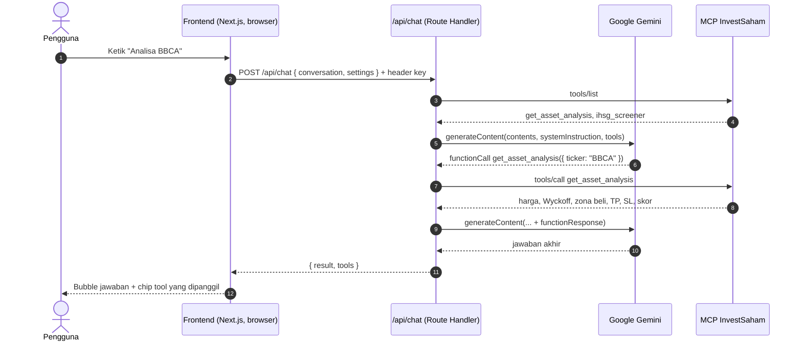

Logika AI tetap di backend, jadi key cadangan tidak pernah sampai ke browser pengunjung widget.

Strategi render:

| Route | Mode | Alasan |
|---|---|---|
| `/` | Static (SSG) | Halaman login sama untuk semua orang |
| `/chat` | Static shell + CSR | Isi chat per pengguna dari localStorage dan tidak butuh SEO |
| `/embed`, `/embed/demo` | Static shell + CSR | Sama dengan `/chat` |
| `/api/chat` | Dynamic | Memanggil Gemini dan MCP per request |

## API `/api/chat`

Format request dan response mengikuti materi kelas (Sesi 3), ditambah `settings`.

```http
POST /api/chat
Content-Type: application/json
x-gemini-key: AIza...           (opsional, fallback ke GEMINI_API_KEY)
x-investsaham-key: ...          (opsional, fallback ke INVESTSAHAM_API_KEY)
```

```json
{
  "conversation": [
    { "role": "user", "text": "Analisa teknikal BBCA" }
  ],
  "settings": { "model": "gemini-2.5-flash", "temperature": 0.4, "tone": "santai" }
}
```

Response sukses:

```json
{
  "result": "Ringkasan: BBCA masih dalam fase markdown ...",
  "tools": [{ "name": "get_asset_analysis", "args": { "ticker": "BBCA" } }]
}
```

Response gagal: `{ "error": "pesan error" }` dengan status 400, 401, atau 500.

Contoh test dengan curl:

```bash
curl -X POST http://localhost:3000/api/chat \
  -H "Content-Type: application/json" \
  -H "x-gemini-key: $GEMINI_API_KEY" \
  -d '{"conversation":[{"role":"user","text":"Apa itu support dan resistance?"}]}'
```

## Embed widget

Tempel kode ini sebelum `</body>` di website mana pun. Ganti domain dengan alamat deploy kamu.

```html
<script
  src="https://domain-kamu.vercel.app/widget.js"
  data-position="bottom-right"
  data-color="#059669"
  defer></script>
```

| Atribut | Nilai |
|---|---|
| `data-position` | `bottom-right` (default) atau `bottom-left` |
| `data-color` | Warna bubble, default `#059669` |

Widget memakai `GEMINI_API_KEY` dan `INVESTSAHAM_API_KEY` dari environment server. Demo lokal: http://localhost:3000/embed/demo.

## Struktur folder

```
src/
├── app/
│   ├── api/chat/route.ts     REST endpoint: validasi, fallback key, panggil Gemini
│   ├── chat/page.tsx         Halaman chat multi sesi
│   ├── embed/page.tsx        Isi iframe widget
│   ├── embed/demo/page.tsx   Contoh website yang memasang widget
│   ├── page.tsx              Halaman login
│   ├── globals.css           Tailwind 4 dan token warna
│   └── styles/motion.scss    Skeleton shimmer dan animasi typing (SCSS)
├── components/               ChatApp, SessionSidebar, SettingsModal, MessageBubble, dll.
├── content/                  Skill analisa dan materi ebook untuk system instruction
└── lib/
    ├── gemini.ts             Loop generateContent dan function calling
    ├── mcp.ts                Client JSON-RPC ke MCP InvestSaham
    ├── prompt.ts             Penyusun system instruction
    ├── storage.ts            State tersimpan di localStorage
    └── types.ts              Tipe data dan default setting
public/
├── widget.js                 Script embed
└── logo-investsaham*.webp    Logo
```

## Deploy

1. Push repo ini ke GitHub.
2. Import di https://vercel.com/new.
3. Isi environment variable `GEMINI_API_KEY`, `INVESTSAHAM_API_KEY`, dan `NEXT_PUBLIC_GOOGLE_CLIENT_ID`.
4. Tambahkan domain Vercel ke **Authorized JavaScript origins** di Google Cloud Console.

## Disclaimer

Isi chat adalah edukasi, bukan ajakan beli atau jual saham. Keputusan dan risiko investasi ada di tangan pengguna. Data pasar berasal dari InvestSaham. Logo dan materi ebook milik InvestSaham.
